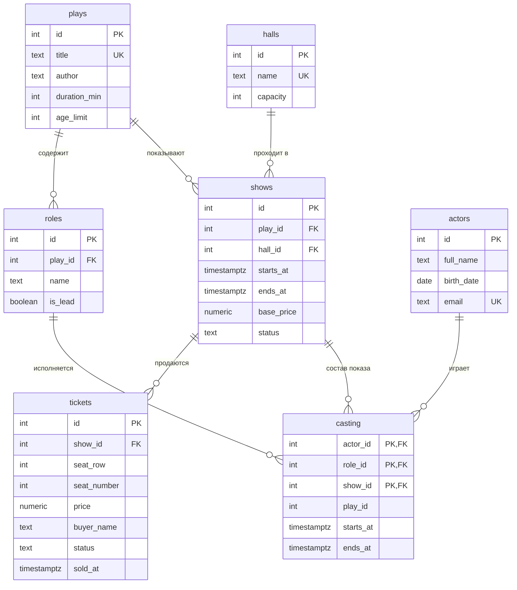

# Театр

Тема № 28: **Театр**. База хранит спектакли, актёров, роли, показы и проданные билеты; нужна администраторам и режиссёрам театра, чтобы составлять афишу и распределять актёров по ролям, и кассирам, чтобы продавать билеты без дублей мест.

|                 |                                                                                      |
| --------------- | ------------------------------------------------------------------------------------ |
| Главная таблица | `shows` (показы)                                                                     |
| Связь N:M       | актёр и роль через `casting`                                                         |
| Бизнес-правило  | актёр не играет в двух показах одновременно (`EXCLUDE` в таблице `casting`)           |
| СУБД            | PostgreSQL 17 в Docker                                                               |

## Описание темы

Театр ставит спектакли (`plays`), у каждого спектакля есть набор ролей (`roles`). Спектакль показывают в залах (`halls`) в конкретное время: это показы (`shows`). На каждый показ роли распределяются между актёрами (`actors`); один актёр может играть много ролей в разных показах, а одну и ту же роль в разных показах могут играть разные актёры. Эту связь N:M хранит таблица `casting`. На каждый показ продаются билеты (`tickets`) на конкретные места. База сама следит, чтобы актёр не оказался в двух показах одновременно, чтобы в одном зале не шло два показа сразу, а одно место нельзя было продать дважды.

## Задания курса

Правила курса, установка и порядок сдачи: [docs/README.md](docs/README.md).

| Лаба                     | Задание                              |
| ------------------------ | ------------------------------------ |
| 1. Модель данных и схема | [docs/lab-1.md](docs/lab-1.md)       |
| 2. Запросы               | [docs/lab-2.md](docs/lab-2.md)       |
| 3. Логика в базе         | [docs/lab-3.md](docs/lab-3.md)       |
| 4. Транзакции и доступ   | [docs/lab-4.md](docs/lab-4.md)       |
| 5. Производительность    | [docs/lab-5.md](docs/lab-5.md)       |
| Витрина к защите         | [docs/showcase.md](docs/showcase.md) |

## Как запустить

```bash
cp .env.example .env          # пароли и порт
docker compose up -d          # при первом запуске выполняются скрипты из db/
dbcheck run demo/lab1.sql     # сценарий лабы 1
```

Работа с базой: `docker compose exec db psql -U postgres -d app`. Сценарии выполняются в `psql` командой `\i /demo/lab1.sql`.

После изменения скриптов в `db/` базу нужно пересоздать: `docker compose down -v && docker compose up -d`.

## ER-диаграмма



`casting` — связующая таблица для N:M «актёр — роль»; первичный ключ `(actor_id, role_id, show_id)`, три внешних ключа: на `actors`, `roles` и `shows`. Дополнительные составные ключи проверяют согласованность копий времени и спектакля (см. ниже).

## Ограничения

| Ограничение   | Таблица и колонки                                    | Зачем                                                                 |
| ------------- | ---------------------------------------------------- | --------------------------------------------------------------------- |
| `UNIQUE`      | `plays(title)`                                       | нет двух спектаклей с одним названием                                 |
| `UNIQUE`      | `actors(email)`                                      | один email — один актёр                                               |
| `UNIQUE`      | `halls(name)`                                        | названия залов не повторяются                                         |
| `UNIQUE`      | `roles(play_id, name)`                               | в спектакле нет двух ролей с одним именем                             |
| `UNIQUE`      | `casting(show_id, role_id)`                          | роль в показе играет один актёр                                       |
| `PRIMARY KEY` | `casting(actor_id, role_id, show_id)`                | запись о составе не повторяется                                       |
| `UNIQUE`      | `tickets(show_id, seat_row, seat_number)`            | место на показ продаётся один раз                                     |
| `CHECK`       | `tickets(price)` `>= 0`                              | цена не бывает отрицательной                                          |
| `CHECK`       | `shows(ends_at > starts_at)`                         | показ не заканчивается раньше начала                                  |
| `CHECK`       | `shows(status)` ∈ planned / done / cancelled       | допустимые статусы                                                    |
| `CHECK`       | `tickets(status)` ∈ sold / reserved / returned       | допустимые статусы билета                                             |
| `CHECK`       | `plays(duration_min)`, `plays(age_limit)`, `halls(capacity)`, `actors(email)`, `actors(birth_date)`, `shows(base_price)`, `tickets(seat_row, seat_number)` | разумные диапазоны и формат значений |
| `EXCLUDE`     | `casting(actor_id, tstzrange(starts_at, ends_at))`   | **бизнес-правило:** актёр не играет в двух показах одновременно       |
| `EXCLUDE`     | `shows(hall_id, tstzrange(starts_at, ends_at))`      | в одном зале не идут два показа одновременно (кроме отменённых)       |
| Составной FK  | `casting(role_id, play_id) → roles(id, play_id)`     | роль относится к тому же спектаклю, что и показ                       |
| Составной FK  | `casting(show_id, play_id, starts_at, ends_at) → shows(...)` | копия времени в `casting` всегда совпадает с показом          |

### Как устроено бизнес-правило

Ограничение `EXCLUDE` работает только в пределах одной таблицы, а время показа лежит в `shows`. Поэтому в `casting` осознанно продублированы `starts_at`, `ends_at` и `play_id`. Дополнительный составной внешний ключ гарантирует, что дубль не разойдётся с `shows` (при переносе показа значения обновятся каскадом: `ON UPDATE CASCADE`). После этого правило записывается одним ограничением `EXCLUDE USING gist (actor_id WITH =, tstzrange(starts_at, ends_at) WITH &&)`: два пересекающихся по времени интервала с одним актёром не пройдут. Проверка в `demo/lab1_bonus.sql`.

## Нормализация

**Исходная таблица**:

`performances(play_title, author, duration_min, hall_name, hall_capacity, starts_at, base_price, actors_and_roles, seat, buyer_name, ticket_price)`

Проблемы: в `actors_and_roles` лежит список «Орлов — Городничий, Соколова — Хлестаков» (нарушение 1НФ), название и автор спектакля повторяются в каждой строке (аномалии обновления), вместимость зала привязана к названию зала, а не к ключу строки.

**1НФ.** Все значения атомарные: список «актёр — роль» превращён в строки `casting`, каждое место и каждый билет — отдельная строка `tickets`.

**2НФ.** Убираем частичные зависимости от части составного ключа (показ + место + роль):
- данные спектакля (`title`, `author`, `duration_min`, `age_limit`) зависят только от спектакля → `plays`;
- данные актёра (`full_name`, `birth_date`, `email`) зависят только от актёра → `actors`;
- название роли зависит только от роли → `roles`;
- время и цена показа зависят только от показа → `shows`.

**3НФ.** Убираем транзитивные зависимости: `hall_capacity` зависит от `hall_name`, а не от показа → выносим в `halls`; `shows` хранит только `hall_id`. Автор и длительность зависят от спектакля, а не от показа → остаются в `plays`.

**Итог:** `plays`, `halls`, `actors`, `roles`, `shows`, `casting`, `tickets`. Единственное осознанное отступление от 3НФ — копия `play_id`, `starts_at`, `ends_at` в `casting`; она защищена составными внешними ключами и нужна, чтобы БД сама проверяла правило.

**Типы данных:** деньги — `numeric(10,2)` (не `float`, чтобы не копились ошибки округления); время — `timestamptz` (показы привязаны к моменту времени, не зависят от часового пояса сервера); статусы — `text` с `CHECK` по списку допустимых значений; идентификаторы — `GENERATED ALWAYS AS IDENTITY`.

## Поведение при удалении (`ON DELETE`)

| Внешний ключ                          | Поведение  | Почему                                                                                               |
| ------------------------------------- | ---------- | ---------------------------------------------------------------------------------------------------- |
| `roles.play_id → plays`               | `CASCADE`  | роли не существуют без спектакля; удалили спектакль — роли уходят вместе с ним                       |
| `shows.play_id → plays`               | `RESTRICT` | нельзя удалить спектакль, пока есть его показы (история и проданные билеты)                          |
| `shows.hall_id → halls`               | `RESTRICT` | нельзя удалить зал, в котором есть показы                                                            |
| `tickets.show_id → shows`             | `RESTRICT` | проданные билеты — финансовые данные; показ с билетами удалять нельзя (его можно отменить статусом `cancelled`) |
| `casting.show_id → shows` и составной `(show_id, play_id, starts_at, ends_at)` | `CASCADE`  | состав показа не имеет смысла без самого показа                                                      |
| `casting.role_id → roles` и составной `(role_id, play_id)` | `RESTRICT` | нельзя удалить роль, которую уже играли в показах                                                    |
| `casting.actor_id → actors`           | `RESTRICT` | нельзя удалить актёра, пока он значится в составах (сохраняется история)                             |

## Данные

`db/02_seed.sql`: 12 спектаклей, 15 актёров, 36 ролей, 14 показов, 42 записи распределения ролей и **1120 билетов** (создаются запросом с `generate_series`), 3 зала.

## Что сделано по лабам

| Лаба | Что сделано                                                                                                  | Сценарий                                                |
| ---- | ------------------------------------------------------------------------------------------------------------ | ------------------------------------------------------- |
| 1    | Схема из 7 таблиц, ограничения, данные (1120 билетов через `generate_series`), нормализация, `ON DELETE`, бизнес-правило через `EXCLUDE` | `demo/lab1.sql`, `demo/lab1_bonus.sql` |
| 2    | 17 запросов: `JOIN`, `GROUP BY`/`HAVING`, «сироты», подзапросы, `INSERT`/`UPDATE`/`DELETE` с откатом, ★ `ROW_NUMBER` и `SUM() OVER`, ★★ `LAG`, `FILTER`, `WITH RECURSIVE` | `demo/lab2.sql` |
| 3    | ...                                                                                                          | `demo/lab3.sql`                                         |
| 4    | ...                                                                                                          | `demo/lab4.sql`, `demo/race.sql`, `demo/race_fixed.sql` |
| 5    | ...                                                                                                          | `demo/lab5.sql`                                         |
